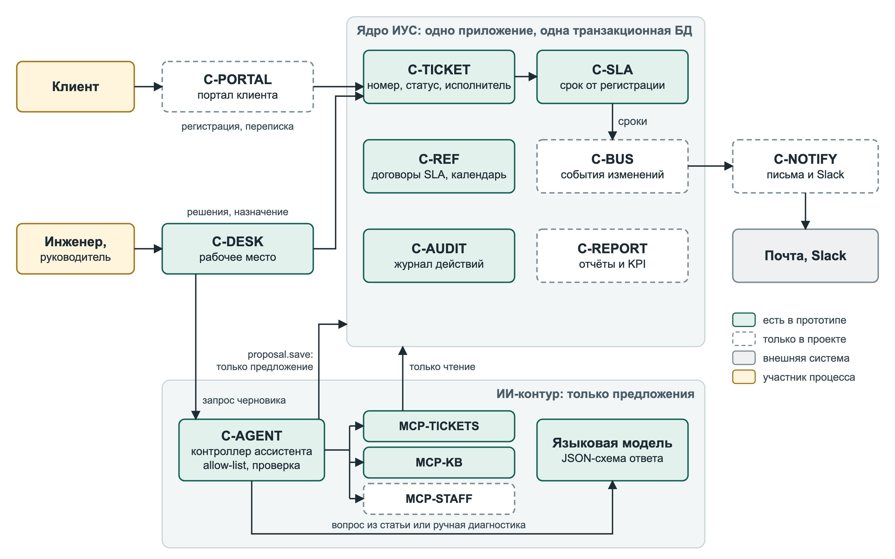

# ИУС обработки обращений в службу технической поддержки (СТП). Этап 2. Архитектура решения

В этой ветке — материалы этапа 2. Все этапы вместе — в ветке [main](https://github.com/plisssa/ius-stp), исходные модель процесса и требования этапа 1 — в ветке [stage-1](https://github.com/plisssa/ius-stp/tree/stage-1).

[Отчёт PDF](stage2/Этап2_Отчёт_вариант12.pdf) · [Отчёт Word](stage2/Этап2_Отчёт_вариант12.docx) · [Слайды](stage2/Этап2_Презентация_вариант12.pptx) · [Описание и запуск прототипа](stage2/README.md) · [Демонстрация рабочего места](https://plisssa.github.io/ius-stp/stage2/)

Практическое задание по дисциплине «Проектирование информационно-управляющих систем», вариант 12. Исполнители: Е. Пузырёва, М. Корнева, В. Веселовский (группа МПМИИ251).

[](stage2/architecture.png)

## Что сделано на этапе

| Результат по заданию | Где лежит |
|---|---|
| Функциональная, информационная и программно-техническая архитектура, обоснование выбора | Отчёт, раздел 1; схемы [architecture.png](stage2/architecture.png), [entities.png](stage2/entities.png), [deployment.png](stage2/deployment.png) |
| Макеты интерфейса и сценарий «агент предлагает — человек утверждает» | Отчёт, подраздел 2.3; [рабочее место](stage2/index.html), [макеты](stage2/mockups/) |
| MCP-манифест интеграций, обоснование «N×M → N+M» | [stage2/tools.json](stage2/tools.json), отчёт, подраздел 2.1 |
| Прототип фрагмента с ИИ-агентом в harness | [stage2/app.py](stage2/app.py), [stage2/mcp_stdio.py](stage2/mcp_stdio.py), отчёт, подраздел 2.2; схема [harness.png](stage2/harness.png) |
| Журнал реализации с точками проверки человеком | [stage2/journal.md](stage2/journal.md) |
| Сравнение классической реализации фрагмента и реализации агентом | Отчёт, подраздел 3.3 |
| Модель угроз и zero trust | Отчёт, подразделы 3.1–3.2; схема [trust.png](stage2/trust.png) |
| Общий сервер команды | [stage2/server/README.md](stage2/server/README.md) |

## Кто что сделал

| Исполнитель | Часть этапа | Разделы отчёта |
|---|---|---|
| Е. Пузырёва | Границы решения, функциональная, информационная и программно-техническая архитектура, сравнение вариантов архитектуры | введение, 1 |
| М. Корнева | MCP-манифест, прототип фрагмента в harness, интерфейс инженера и макеты | 2 |
| В. Веселовский | Модель угроз, zero trust, сравнение с классической реализацией, проверки и журнал, трассируемость | 3, 4, заключение |

## Как запустить

```sh
ollama pull qwen2.5:0.5b
python3 stage2/app.py
```

Рабочее место откроется на http://127.0.0.1:8765. Проверки, общий сервер и показ на защите описаны в [stage2/README.md](stage2/README.md).
