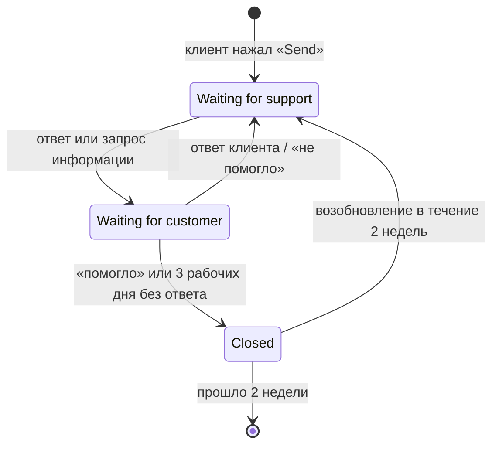
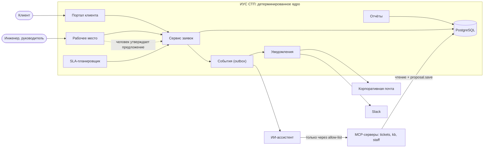

# ИУС обработки обращений в службу технической поддержки (СТП)

Проектирование информационно-управляющей системы, которая регистрирует обращения клиентов, контролирует SLA первого ответа, рассылает уведомления, поддерживает назначение, эскалацию, закрытие и возобновление заявок и строит отчёты. ИИ-ассистент помогает инженерам, но только предлагает — решения принимает человек.

## Процесс обработки обращения (BPMN 2.0)


Исходная модель — [`models/stp-process.bpmn`](models/stp-process.bpmn) (Camunda Modeler). Описание элементов и бизнес-правил — [`docs/01-process-analysis.md`](docs/01-process-analysis.md).

## Жизненный цикл заявки



## Варианты использования (UML)


## Архитектура



Подробно — [`specs/001-stp-ticket-processing/plan.md`](specs/001-stp-ticket-processing/plan.md) и [`research.md`](specs/001-stp-ticket-processing/research.md).

## Структура репозитория

```
README.md                    — этот файл
docs/
  00-plan-stage1.md          — план этапа 1, gates, команды Spec Kit, вопросы преподавателю
  01-process-analysis.md     — объект, роли, BR-01…23, статусы, AS-IS/TO-BE, ASM, выбор нотации и CASE, варианты использования
  02-requirements.md         — ФТ-01…33, KPI-01…11, НФТ-01…15
  03-ears.md                 — EARS-01…15 с критериями приёмки
  04-ai-requirements.md      — ИИ-01…12: требования к ИИ-ассистенту
  05-traceability.md         — EARS → элемент BPMN → компонент архитектуры → задачи
  img/stp-process.svg        — изображение BPMN-модели для README
models/
  stp-process.bpmn           — BPMN 2.0, открывать в Camunda Modeler или на demo.bpmn.io
  use-cases.svg              — UML-диаграмма вариантов использования (UC-01…19)
journal/
  agent-log.md               — журнал действий ИИ-агента с human-gates
  agent-weaknesses.md        — заготовки для раздела «Что ИИ-агент сделал плохо»
reports/                     — отчёт по этапу 1 (.docx, .pdf)
.specify/memory/constitution.md — принципы P1–P7 (конституция Spec Kit)
.specify/                    — шаблоны и скрипты Spec Kit
specs/                       — артефакты SDD-цикла: spec.md, plan.md, tasks.md
```

## Схема идентификаторов

| Префикс | Что | Где определено |
|---|---|---|
| BR-xx | Бизнес-правило из текста кейса | `docs/01` §1.3 |
| ASM-xx | Допущение (в кейсе нет, ждёт согласования) | `docs/01` §1.8 |
| P-xx | Проблема AS-IS | `docs/01` §1.6 |
| ФТ / НФТ / KPI | Требования и показатели | `docs/02` |
| EARS-xx | Ключевое требование в EARS | `docs/03` |
| ИИ-xx | Требование к ИИ-компоненту | `docs/04` |
| UC-xx | Вариант использования | `docs/01` §1.11 |
| P1–P7 | Принцип constitution | `.specify/memory/constitution.md` |
| T_ / GW_ / ICE_ … | Элементы BPMN-модели | `models/stp-process.bpmn` |
| C- / MCP- | Компоненты архитектуры | `docs/05` §5.1 |

## Главное правило проекта

Модель предлагает · детерминированное ядро исполняет · человек утверждает. Предметная область кейса не меняется: ИИ встраивается только в контур выполнения.
