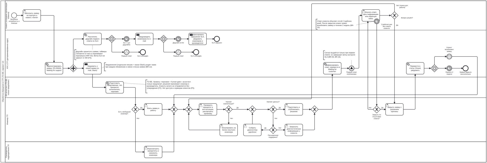
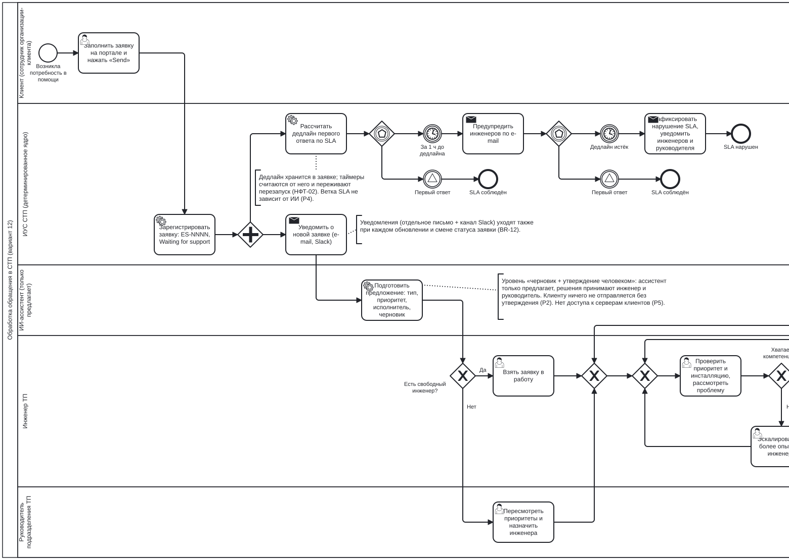
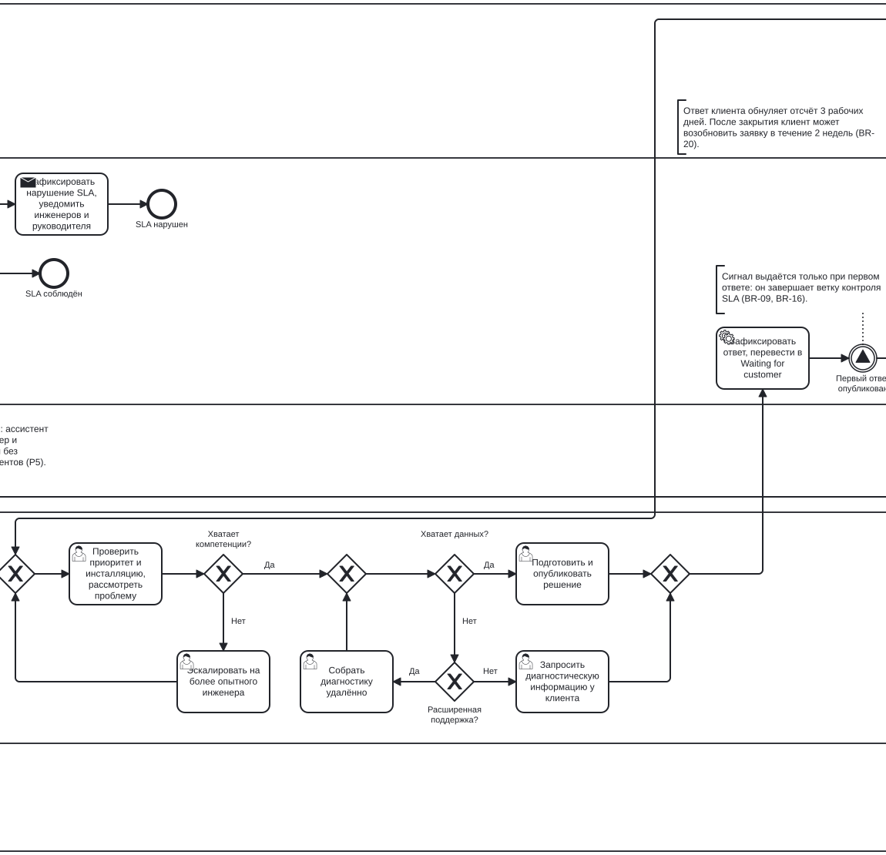
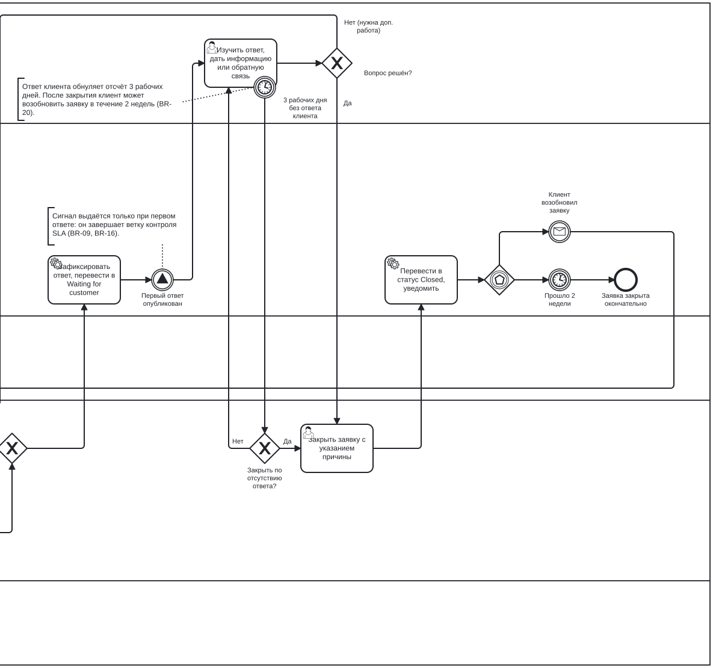
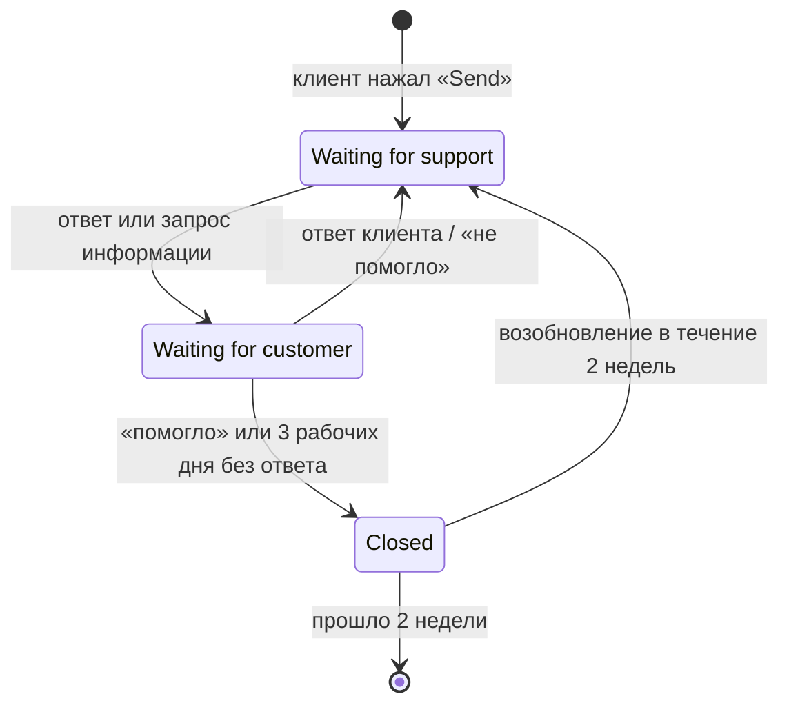
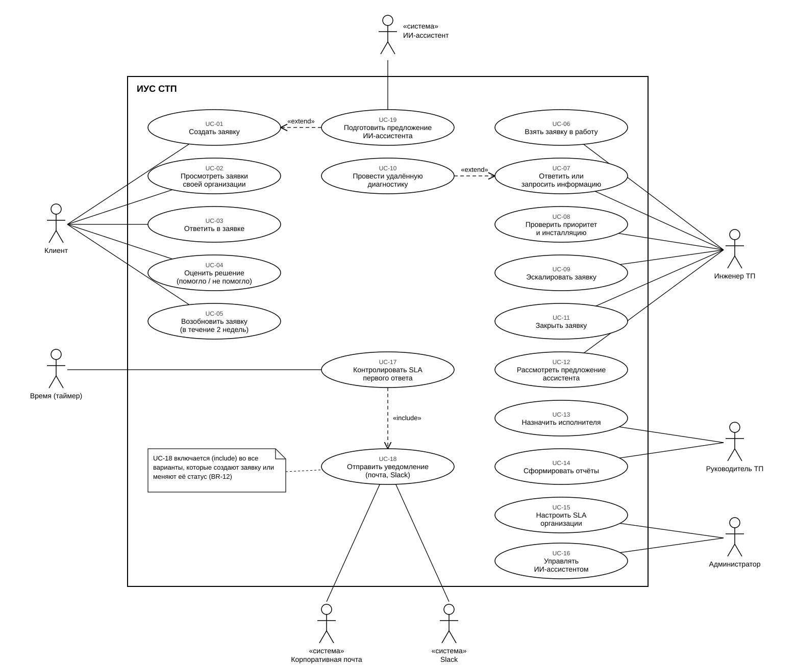

# ИУС обработки обращений в службу технической поддержки (СТП)

Практическое задание по дисциплине «Проектирование информационно-управляющих систем», вариант 12. Исполнители: Е. Пузырёва, М. Корнева, В. Веселовский (группа МПМИИ251).

Проектирование информационно-управляющей системы, которая регистрирует обращения клиентов, контролирует SLA первого ответа, рассылает уведомления, поддерживает назначение, эскалацию, закрытие и возобновление заявок и строит отчёты. ИИ-ассистент помогает инженерам, но только предлагает — решения принимает человек.

## Кто что сделал

| Исполнитель | Часть задания | Файлы | Разделы отчёта |
|---|---|---|---|
| Е. Пузырёва | Анализ кейса (бизнес-правила, допущения, проблемы), модель процесса BPMN 2.0 и UML-диаграмма, обоснование нотации и CASE-средства, функциональные и нефункциональные требования, KPI | `README.md`, `docs/01`, `docs/02`, `models/` | введение, 1–3, прил. А |
| М. Корнева | Требования в нотации EARS с критериями приёмки, требования к ИИ-ассистенту, конституция, спецификация (шаг Specify) | `docs/03`, `docs/04`, `.specify/memory/constitution.md`, `specs/…/spec.md` | 4–6, 7.2 |
| В. Веселовский | План (шаг Plan), сценарии проверки, задачи (шаг Tasks), матрица трассируемости, журналы | `specs/…/plan.md`, `research.md`, `quickstart.md`, `tasks.md`, `docs/05`, `journal/` | 7.1, 7.3, 7.4, 8, заключение, прил. Б, В |

## Процесс обработки обращения (BPMN 2.0)

[](docs/img/stp-process.svg)

**[Открыть интерактивную модель](https://plisssa.github.io/ius-stp/)** — масштаб, переход к частям процесса, описание элемента по щелчку.

<details>
<summary><b>Часть 1.</b> Регистрация заявки, контроль срока первого ответа, предложение ИИ-ассистента, назначение исполнителя</summary>

[](docs/img/stp-process-part1.svg)
</details>

<details>
<summary><b>Часть 2.</b> Проверка заявки, эскалация, диагностика и подготовка ответа</summary>

[](docs/img/stp-process-part2.svg)
</details>

<details>
<summary><b>Часть 3.</b> Первый ответ, ожидание клиента, закрытие и возобновление заявки</summary>

[](docs/img/stp-process-part3.svg)
</details>

Исходная модель — [`models/stp-process.bpmn`](models/stp-process.bpmn): открывается в Camunda Modeler или без установки на [demo.bpmn.io](https://demo.bpmn.io) (перетащите файл в окно браузера) — там схему можно двигать, приближать и смотреть свойства элементов. Описание элементов и бизнес-правил — [`docs/01-process-analysis.md`](docs/01-process-analysis.md).

## Жизненный цикл заявки



## Варианты использования (UML)



## Структура репозитория

```
README.md                         — этот файл
docs/
  01-process-analysis.md          — анализ процесса: участники, бизнес-правила кейса (BR), статусы заявки,
                                    модель, проблемы, допущения (ASM), выбор нотации и программы, варианты использования
  02-requirements.md              — функциональные (ФТ) и нефункциональные (НФТ) требования, показатели (KPI)
  03-ears.md                      — 15 ключевых требований в нотации EARS с критериями приёмки
  04-ai-requirements.md           — требования к ИИ-ассистенту инженера (ИИ-01…12)
  05-traceability.md              — матрица трассируемости: требование → правило → элемент модели → компонент → задачи
  img/stp-process.svg             — изображение модели процесса для этой страницы
models/
  stp-process.bpmn                — модель процесса BPMN 2.0 (Camunda Modeler)
  use-cases.svg                   — UML-диаграмма вариантов использования
.specify/memory/constitution.md   — конституция проекта: 7 принципов
specs/001-stp-ticket-processing/  — спецификация (spec), план (plan) и задачи (tasks), подготовленные в GitHub Spec Kit
journal/1-sdd-cycle/              — журнал работы над проектом: действия ИИ-агента и точки утверждения
journal/2-ai-assistant/           — пример журнала ИИ-ассистента системы на тестовых заявках
reports/                          — отчёт по этапу 1 (PDF и Word)
index.html                        — интерактивная модель процесса (GitHub Pages)
.specify/                         — шаблоны и скрипты Spec Kit
```

## Схема идентификаторов

| Префикс | Что | Где определено |
|---|---|---|
| BR-xx | Бизнес-правило из текста кейса | `docs/01` §1.3 |
| ASM-xx | Допущение — сведения, которых нет в тексте кейса | `docs/01` §1.8 |
| P-xx | Проблема текущего процесса | `docs/01` §1.6 |
| ФТ / НФТ / KPI | Требования и показатели | `docs/02` |
| EARS-xx | Ключевое требование в EARS | `docs/03` |
| ИИ-xx | Требование к ИИ-компоненту | `docs/04` |
| UC-xx | Вариант использования | `docs/01` §1.11 |
| P1–P7 | Принцип constitution | `.specify/memory/constitution.md` |
| T_ / GW_ / ICE_ … | Элементы BPMN-модели | `models/stp-process.bpmn` |
| C- / MCP- | Компоненты системы | `docs/05` §5.1 |

## Главное правило проекта

ИИ-ассистент предлагает, система выполняет правила, человек утверждает решения. Процесс и правила кейса не меняются: ассистент только помогает инженерам.
