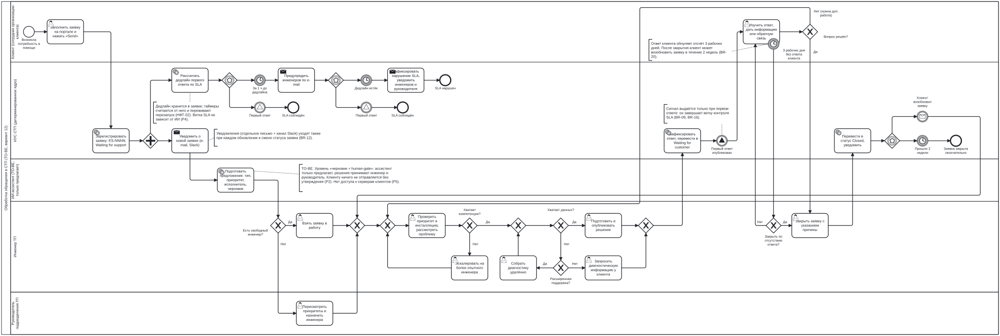

# ИУС обработки обращений в службу технической поддержки (СТП)

Практическое задание по дисциплине «Проектирование информационно-управляющих систем», вариант 12. Исполнители: Е. Пузырёва, М. Корнева, В. Веселовский (группа МПМИИ251).

Проектирование информационно-управляющей системы, которая регистрирует обращения клиентов, контролирует SLA первого ответа, рассылает уведомления, поддерживает назначение, эскалацию, закрытие и возобновление заявок и строит отчёты. ИИ-ассистент помогает инженерам, но только предлагает — решения принимает человек.

## Этапы проекта

| Этап | Что сделано | Материалы | Ветка этапа |
|---|---|---|---|
| 1. Модель процессов и требования | Модель процесса BPMN 2.0, требования и KPI, требования в нотации EARS, требования к ИИ-ассистенту, конституция, цикл Specify → Plan → Tasks, матрица трассируемости | [Описание](docs/README.md) · [Отчёт](reports/Этап1_Отчёт_вариант12_краткий.pdf) · [Интерактивная модель](https://plisssa.github.io/ius-stp/) | [stage-1](https://github.com/plisssa/ius-stp/tree/stage-1) |
| 2. Архитектура решения | Функциональная, информационная и программно-техническая архитектура, MCP-манифест, прототип фрагмента с ИИ-агентом, интерфейс и макеты, модель угроз | [Описание и запуск](stage2/README.md) · [Отчёт](stage2/Этап2_Отчёт_вариант12.pdf) · [Демонстрация рабочего места](https://plisssa.github.io/ius-stp/stage2/) | [stage-2](https://github.com/plisssa/ius-stp/tree/stage-2) |

В ветке main собраны все этапы. В ветке каждого этапа — только его материалы и описание.

## Этап 1. Модель процессов и требования

Процесс обработки обращения смоделирован в BPMN 2.0, из модели выведены требования к системе и ИИ-ассистенту, спецификация прошла цикл Spec Kit с проверкой человеком. Подробнее — [docs/README.md](docs/README.md).

[](docs/img/stp-process.svg)

**[Открыть интерактивную модель](https://plisssa.github.io/ius-stp/)** — масштаб, переход к частям процесса, описание элемента по щелчку.

## Этап 2. Архитектура решения

Ядро ИУС — модульное приложение с одной транзакционной базой, ИИ-контур отделён от него и получает данные только через MCP-серверы. Фрагмент «черновик первого ответа» реализован в прототипе: агент готовит черновик, инженер принимает, изменяет или отклоняет его. Подробнее и запуск — [stage2/README.md](stage2/README.md).

[](stage2/architecture.png)

**[Открыть рабочее место инженера](https://plisssa.github.io/ius-stp/stage2/)** — браузерная демонстрация без модели; полный стенд с моделью запускается локально или на общем сервере.

## Кто что сделал

| Исполнитель | Этап 1 | Этап 2 |
|---|---|---|
| Е. Пузырёва | Анализ кейса, модель процесса BPMN 2.0 и UML-диаграмма, выбор нотации и CASE-средства, функциональные и нефункциональные требования, KPI | Границы решения, функциональная, информационная и программно-техническая архитектура, сравнение вариантов архитектуры (введение, раздел 1) |
| М. Корнева | Требования в нотации EARS, требования к ИИ-ассистенту, конституция, спецификация | MCP-манифест, прототип фрагмента в harness, интерфейс инженера и макеты (раздел 2) |
| В. Веселовский | План, сценарии проверки, задачи, матрица трассируемости, журналы | Модель угроз, zero trust, сравнение с классической реализацией, проверки и журнал, трассируемость (разделы 3, 4, заключение) |

## Структура репозитория

```
README.md            — обзор проекта (этот файл)
docs/                — этап 1: анализ процесса, требования, EARS, требования к ИИ, трассируемость; описание этапа — docs/README.md
models/              — этап 1: модель процесса BPMN 2.0 и диаграмма вариантов использования
.specify/, specs/    — этап 1: конституция, спецификация, план и задачи (Spec Kit)
journal/             — этап 1: журнал работы и пример журнала ИИ-ассистента
reports/             — этап 1: отчёты (PDF и Word)
index.html           — интерактивная модель процесса (GitHub Pages)
stage2/              — этап 2: прототип, схемы, макеты, журнал реализации, отчёт и слайды
```

## Схема идентификаторов

| Префикс | Что | Где определено |
|---|---|---|
| BR-xx | Бизнес-правило из текста кейса | `docs/01` §1.3 |
| ASM-xx | Допущение — сведения, которых нет в тексте кейса | `docs/01` §1.8 |
| ФТ / НФТ / KPI | Требования и показатели | `docs/02` |
| EARS-xx | Ключевое требование в EARS | `docs/03` |
| ИИ-xx | Требование к ИИ-компоненту | `docs/04` |
| P1–P7 | Принцип конституции | `.specify/memory/constitution.md` |
| T_ / GW_ / ICE_ … | Элементы BPMN-модели | `models/stp-process.bpmn` |
| C- / MCP- | Компоненты системы и серверы инструментов | `docs/05` §5.1, `stage2/tools.json` |
| G0–G6, G7–G10 | Точки проверки человеком этапов 1 и 2 | `journal/1-sdd-cycle/`, `stage2/journal.md` |

## Главное правило проекта

ИИ-ассистент предлагает, система выполняет правила, человек утверждает решения. Процесс и правила кейса не меняются: ассистент только помогает инженерам.
