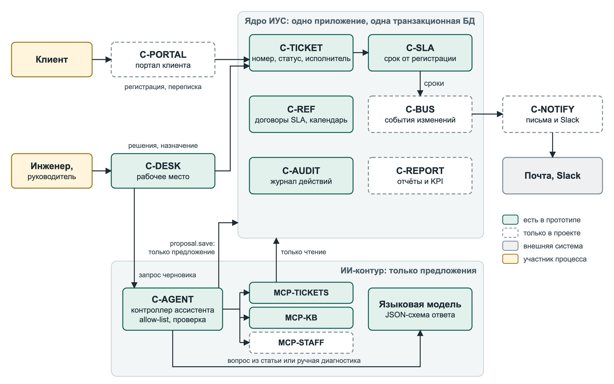

# Этап 2. Архитектура службы технической поддержки

[Отчёт PDF](Этап2_Отчёт_вариант12.pdf) · [Отчёт Word](Этап2_Отчёт_вариант12.docx) · [Слайды](Этап2_Презентация_вариант12.pptx)

[](architecture.png)

## Учебный сервис

Сервис реализует фрагмент ИУС СТП от заявки клиента до первого ответа и закрытия, с ИИ-ассистентом и контролем SLA. Вход по логину и паролю; у учётной записи есть роли: клиент, инженер, руководитель. На общем стенде используется одна запись admin со всеми ролями.

| Раздел | Что можно сделать | Правила кейса |
|---|---|---|
| Портал клиента | Создать обращение (категория, тип, приоритет, описание, кнопка «Send»), видеть статус и срок, переписываться с инженером, отметить «помогло» или «не помогло», возобновить закрытую заявку | BR-01…04, BR-20…22, ASM-03, ASM-04, ASM-11 |
| Очередь инженера | Очередь с поиском, фильтрами и цветом срока SLA; карточка с перепиской, параметрами, статьёй базы знаний и журналом; ответы клиенту; закрытие «нет ответа клиента» через 3 рабочих дня | BR-05, BR-18, BR-19, ASM-06 |
| Ассистент | А1 — тип обращения и А2 — приоритет по описанию от обученного классификатора; А4 — черновик первого ответа от языковой модели в harness. Применяется только решение инженера: «Принять», «Изменить», «Отклонить» | ИИ-01…11, EARS-14, EARS-15 |
| Контроль SLA | Срок первого ответа по договору организации, предупреждение за час и нарушение срока в журнале уведомлений: письма инженерам и руководителю, сообщения в Slack | BR-07…12, ASM-02, ASM-10 |
| Отчёты и KPI | Заявки по типам (ФТ-27) и приоритетам (ФТ-29), сотрудники с неудовлетворёнными заявками (ФТ-28), доля ответов в срок (KPI-01), время ответа от норматива (KPI-02), решения по предложениям ИИ, качество классификатора | ФТ-27…29, ASM-09 |

Письма и сообщения Slack не уходят наружу: они записываются в журнал уведомлений с адресатом и текстом.

## Модели

- **Языковая модель** Qwen 2.5 0.5B через Ollama готовит черновик первого ответа (А4). Контроллер передаёт ей одну заявку и одну статью и принимает только ответ по JSON-схеме: вопрос из статьи или «нужна ручная диагностика». Без модели инженер отвечает вручную в том же окне.
- **Классификатор** (TF-IDF и логистическая регрессия) обучен на 5282 переведённых на русский обращениях техподдержки и проверен на 1321 отложенном. Тип обращения: accuracy 0,978, macro-F1 0,955 при базовой 0,674. Приоритет по описанию: accuracy 0,608, macro-F1 0,562 при базовой 0,473 — поэтому А2 показывается как подсказка. Данные синтетические, оценка оптимистична. Подробности — [ml/README.md](ml/README.md), метрики — [ml/metrics.json](ml/metrics.json).

## Где работает

**Общий сервис для всех — GitHub Codespaces.** Владелец репозитория запускает сервис перед показом; все открывают один HTTPS-адрес и входят по личным логинам. Бесплатная квота GitHub — 120 ядро-часов в месяц, то есть до 60 часов работы на машине с двумя ядрами.

1. Отправьте код на GitHub (`git push`). На странице репозитория: **Code → Codespaces → Create codespace on main**.
2. В терминале Codespace выполните:
   ```sh
   bash stage2/server/start_codespace.sh
   ```
   Первый запуск занимает 5–10 минут: собираются контейнеры и скачивается модель. Скрипт создаст учётную запись **admin / admin** со всеми ролями (файл `stage2/team-access/users.json`, исключён из Git) и выведет адрес сервиса `https://ИМЯ-CODESPACE-8765.app.github.dev`. Личные записи команды и преподавателей вместо неё: `python3 stage2/server/make_users.py --team`, затем повторный запуск скрипта.
3. Сделайте порт публичным, если скрипт не сделал этого сам: вкладка **PORTS** → строка 8765 → правый клик → **Port Visibility → Public**.
4. Отправьте участникам адрес и данные для входа. При первом заходе GitHub показывает предупреждение о порте Codespace — нажмите **Continue**.
5. После показа остановите Codespace (**Codespaces → Stop codespace**); база сохраняется в `stage2/team-access/state` и будет на месте при следующем запуске той же командой.

Codespace останавливается сам после простоя (по умолчанию 30 минут без работы в редакторе); перед защитой увеличьте время в github.com/settings/codespaces → Default idle timeout. Остановленный Codespace по ссылке не запускается — его запускает владелец.

**Локально на Mac.** Запустите приложение Ollama, затем из корня проекта:

```sh
ollama pull qwen2.5:0.5b
python3 stage2/app.py
```

Откройте **http://127.0.0.1:8765**. Без файла учётных записей открывается сессия «Инженер Демо» со всеми ролями. Переменные STP_PORT и STP_DB задают порт и файл базы. Сервер инструментов запускается в песочнице macOS без сети и записи.

**Свой сервер.** Docker Compose с HTTPS-прокси и сервером инструментов в отдельном контейнере без сети — [server/README.md](server/README.md).

**Hugging Face Spaces.** Пакет `space/` (Docker-образ с приложением, сервером инструментов и моделью, секрет `STP_USERS`, отправка `bash stage2/space/push.sh ЛОГИН/ius-stp`) рассчитан на Docker Space. С 2026 года Docker и CPU Basic на Hugging Face доступны только с платным планом PRO, поэтому для бесплатного показа используется Codespaces.

## Показ на защите

1. Войдите, откройте «Портал клиента» и создайте обращение. Заявка получает номер ES-XXXX, статус «Waiting for support», исполнителя «Unassigned» и срок первого ответа по договору.
2. В разделе «Уведомления» видны письмо инженерам и сообщение в Slack о новой заявке; для приоритета P1 сразу приходит предупреждение о сроке (ASM-02).
3. В «Очереди» откройте заявку. Ассистент предлагает тип и оценку приоритета; примите или исправьте тип. Нажмите «Подготовить черновик», сверьте вопрос со статьёй, примите, измените или отклоните его.
4. Вернитесь в портал: ответ инженера виден клиенту, статус — «Waiting for customer». Отметьте «Не помогло» и «Помогло».
5. Откройте журнал заявки (вызовы инструментов, решения с логином) и «Отчёты и KPI».

Проверки запускаются из корня проекта при работающей Ollama:

```sh
python3 stage2/verify.py
python3 stage2/verify_team.py
python3 stage2/server/verify_shared.py
```

## Файлы

| Файл | Назначение |
|---|---|
| app.py | HTTP-сервер, роли и сессии, заявки и переписка, контроль SLA, уведомления, отчёты, harness ассистента |
| web/ | Интерфейс: вход, портал клиента, очередь инженера, отчёты, уведомления |
| classifier.py, ml/ | Классификатор А1–А2: применение, обучение, перевод, веса и метрики |
| tools.json, mcp_stdio.py, read-only.sb | Манифест инструментов, MCP-сервер чтения (база только на чтение, без данных автора) и профиль песочницы macOS |
| data.json, sla.json | 243 учебные заявки и 6 статей ([DATASET.md](DATASET.md)); договоры SLA, нормативы и нерабочие дни |
| space/ | Hugging Face Spaces (нужен план PRO): Dockerfile, запуск, описание, отправка |
| Dockerfile, compose.yaml, server/, ../.devcontainer/ | Общий сервер: Codespaces или своя VM — приложение, сервер инструментов без сети, модель; учётные записи |
| verify.py, verify_team.py, server/verify_shared.py | Автоматические проверки |
| architecture.png, entities.png, deployment.png, harness.png, trust.png, workplace.png, decision.png, mockups/ | Схемы, снимки экрана и макеты отчёта |
| journal.md | Журнал реализации с точками проверки |
| index.html, pages-demo.js | Браузерная демонстрация на GitHub Pages без сервера |

Компоновка рабочего места (очередь, история и редактор, параметры заявки) следует принятой в системах поддержки — см. [Zendesk Agent Workspace](https://support.zendesk.com/hc/en-us/articles/4408881937306-Getting-started-with-Zendesk-Suite-Introduction).
